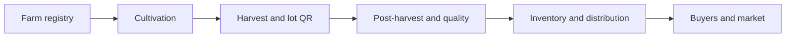

# UpTerra

**Raising the value of local harvests.**

We build digital traceability systems, on the web and on mobile, that help local growers and cooperatives deliver trusted, high-quality produce and compete for better prices.

[About](#about) · [What We Build](#what-we-build) · [How It Works](#how-it-works) · [Roadmap](#roadmap) · [Team](#team)

---

## About

UpTerra is an agritech team from Indonesia. We believe local farmers grow produce that deserves a higher price, but often lack the records and tools to prove its quality.

We help farmer cooperatives and local communities record, monitor, and trace their produce from the orchard to the buyer. When every product has a clear origin and quality history, growers gain stronger bargaining power, buyers gain trust, and local communities become more competitive.

The name combines **Up**, to grow, and **Terra**, the Latin word for earth. Our logo reflects the same idea: the letter **U** shaped as a pot, with a sprout forming the letter **T** growing from within.

## The Problem

| Challenge | What it means |
| --- | --- |
| **Fragmented data** | Records on orchards, cultivation, harvest, quality, stock, and distribution are kept separately, often on paper, and are not connected. |
| **Low selling value** | Without proof of origin and quality, produce is sold at uniform low prices, regardless of how well it was grown. |
| **Weak competitiveness** | Larger buyers expect consistent quality, food safety, and steady supply, which small growers struggle to demonstrate. |
| **Decisions based on estimates** | Harvest timing, stock, and pricing are decided by habit rather than data. |

## What We Build

An integrated platform, made up of a web dashboard for cooperatives and a mobile app for growers and field officers, that gives every tree and every product lot a digital identity and a traceable history across six stages of the value chain:

| Stage | Coverage |
| --- | --- |
| **1. Farm & grower registry** | GIS mapping, grower profiles, and production inputs |
| **2. Cultivation & pre-harvest** | Good Agricultural Practices (GAP) records, pest control, and harvest prediction |
| **3. Harvest & product lots** | Harvest time, volume, ripeness, and batch records, with a QR code for every lot |
| **4. Post-harvest & quality** | Sorting, grading, packing, and shelf-life tracking |
| **5. Inventory & distribution** | Stock levels, storage conditions, and delivery status |
| **6. Market & buyers** | Origin and quality records that buyers can verify by scanning a QR code |

A buyer who scans the QR code on a product can see where it was grown, how it was cared for, and how it was graded. That transparency is what turns ordinary produce into premium produce.

## How It Works

Our working principles:

1. **Data capture** — record activities at every stage, from planting to sale, directly in the field through the mobile app.
2. **Lot identity** — assign a QR code to each tree and product lot, scannable from any phone.
3. **System integration** — connect production, quality, inventory, distribution, and transactions in one platform.
4. **Analytics** — use machine learning to forecast harvests and plan supply.
5. **Dashboards** — present the data so cooperatives can make faster, better decisions.

## Impact We Aim For

- **Higher selling value** — graded, traceable produce that can command premium prices.
- **Stronger bargaining position** — growers and cooperatives negotiate with data, not guesswork.
- **Consistent quality and supply** — better planning through harvest forecasting and stock visibility.
- **Stronger local communities** — cooperatives that are better organized, more efficient, and more competitive.

## Tech Stack

<!-- Sesuaikan dengan teknologi yang benar-benar kalian pakai.
     Ikon baris atas: daftar kode di https://skillicons.dev (parameter i=...)
     Badge tabel: https://shields.io dan https://simpleicons.org untuk nama logo -->

 

| Area | Technologies |
| --- | --- |
| Frontend |     |
| Mobile |     |
| Backend |    |
| Database |  |
| AI / ML |   |
| Maps / GIS |  |
| DevOps |   |
| Design |  |

## Platform Architecture

| Layer | Purpose |
| --- | --- |
| Web-based ERP | Integrated modules for production, quality, inventory, distribution, transactions, and traceability |
| Mobile app | Field data entry, QR scanning, and harvest records for growers and field officers |
| QR code identity | Unique digital identity for every tree and product lot |
| Integrated database | A single source of truth across the value chain |
| AI/ML & predictive analytics | Harvest forecasting and data-driven quality decisions |
| Dashboards | Real-time overview of lots, stock, and supply status |

## Who We Work With

- **Farmer cooperatives** — pilot sites, production aggregators, and managers of quality, stock, and sales data
- **Local growers** — the people whose harvests the platform is built to raise in value
- **Value chain actors** — post-harvest handlers, collectors, and buyers
- **Government and academia** — agricultural agencies and research institutions

## Roadmap

**Phase 1 — Platform development and implementation**

- [x] Field survey with partner cooperative
- [ ] Baseline assessment and data mapping
- [ ] System design
- [ ] Web platform development and integration
- [ ] Mobile app for field recording and QR scanning
- [ ] AI/ML modeling and validation
- [ ] Testing, pilot deployment, and user training
- [ ] Evaluation, SOP, and handover

**Phase 2 — Business process and cooperative model**

- [ ] Business process model
- [ ] Operational and traceability SOPs
- [ ] Cooperative business model
- [ ] Alignment with quality and market standards
- [ ] Scaling roadmap and sustainability plan

## Team

<!-- Ganti USERNAME_2 s.d. USERNAME_5 dengan username GitHub anggota, lalu isi nama dan perannya. -->

|  |  |  |  |  |
| :---: | :---: | :---: | :---: | :---: |
| [**Bintangilham**](https://github.com/Bintangilham10) | [**Royzidomi**](https://github.com/Roy-Zidomi) | [**Hafidz**](https://github.com/hafidz03-abd) | [**Name**](https://github.com/USERNAME_4) | [**Name**](https://github.com/USERNAME_5) |
| Role | Role | Role | Role | Role |

## Contributing

We welcome feedback and collaboration.

- Found a bug or have a feature idea? Open an issue in the relevant repository.
- Want to contribute code? Fork the repository, create a branch, and submit a pull request with a clear description of your changes.

## Contact

- Website: [lihatkebunku.id](https://lihatkebunku.id)
- GitHub: [github.com/UpTerra](https://github.com/UpTerra)

---

&copy; 2026 UpTerra. Built in Indonesia.

